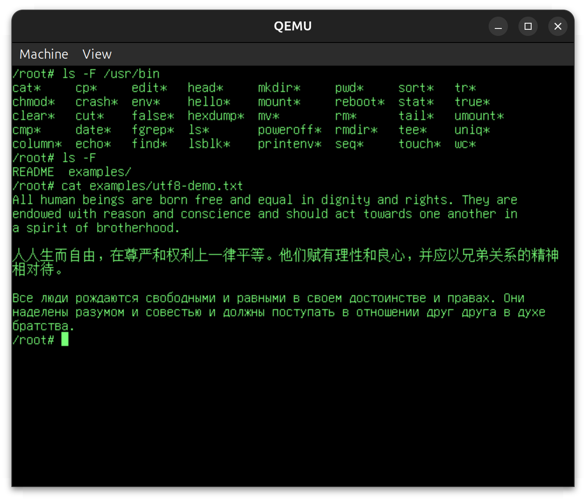
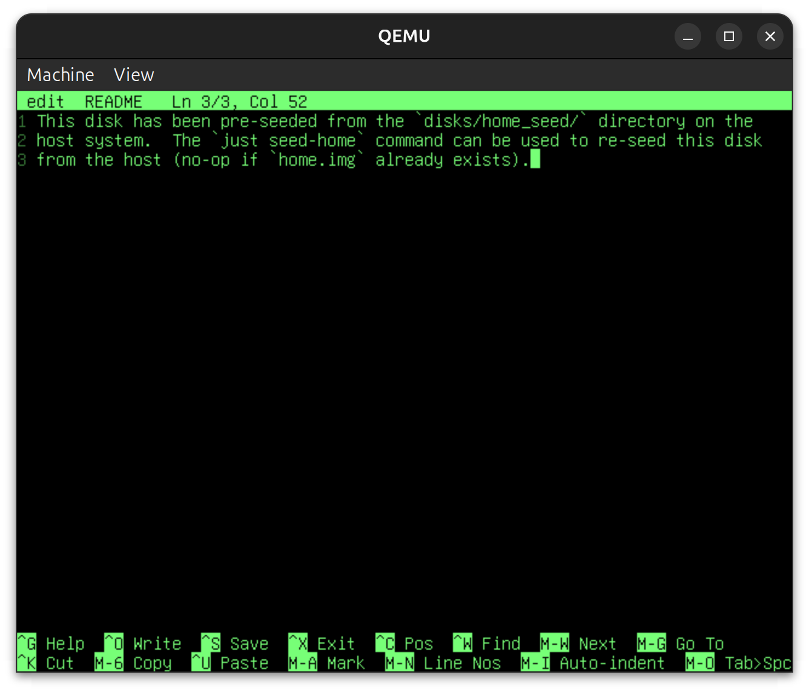

# VirtOS: a (very) simple operating system

This is a minimal operating system for the QEMU emulator with VirtIO devices.

- Uses raw keyboard events for input, as opposed to ANSI escape sequences.
- Runs on the `virt` machine type in QEMU using the AArch64 architecture.
- Inspired by Linux, but much simpler &mdash; for educational purposes only.
- Single-user, single-threaded, simple FAT-based filesystem.
- Unicode support (display only, input assumes US-QWERTY layout).





## To build and run

On Debian or Ubuntu (x86-64 or AArch64 host; on x86-64 QEMU emulates the AArch64 CPU, which is
slower but works the same):

```bash
sudo apt update && sudo apt install -y build-essential git just rustup \
    qemu-system-aarch64 qemu-system-gui binutils-aarch64-linux-gnu
rustup default stable
rustup target add aarch64-unknown-none-softfloat
git clone https://github.com/yinchi/virtos.git
cd virtos
just run
```

`just run` builds the kernel and the user programs, creates the system disk and, the first time,
a persistent home disk (`home.img`, seeded from `disks/home_seed`; `just reseed-home` starts it
over), and opens QEMU's window. The shell is in the window; the serial console is your terminal.
Quit QEMU with `Ctrl+A` then `X` in the terminal, or run `poweroff` in the OS.

Try `ls`, `cat /etc/environment`, `edit notes.txt` (a nano-style editor: `^G` for help) and
`ls /usr/bin` for what is installed.

> [!WARNING]
> The OS was tested on an AArch64 host only; x86-64 support is unverified.

## To test

```bash
sudo apt install -y python3 mtools dosfstools   # for the end-to-end tests only
just test            # host unit tests, then the end-to-end QEMU tests
just test-host       # only the unit tests (no QEMU needed)
```

See `test/README.md` for how the end-to-end tests drive the OS. `just --list` shows every recipe
(`just lint` runs the formatter check and clippy over every crate).
